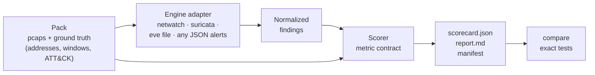

# NetWatch Bench

**Unit tests for network detections.** Replay labelled traffic through any
IDS, score every alert against ground truth, and get a scorecard you can
defend: what it caught, what it missed, how much noise it made, and whether
the difference from the last run is real.

```bash
git clone https://github.com/tdinh-dev-sec-scientist/Netwatch_SOC && cd Netwatch_SOC
pip install pyyaml
python -m netwatch_bench run --pack packs/cicids2018-demo --engine netwatch
```

```
netwatch on CSE-CIC-IDS2018 demo (45 minutes, 7 attacks)

  Attacks detected  7 / 7  (100%, 95% CI 65–100%)
  Right technique   7 / 7  (95% CI 65–100%; missed attacks count as wrong)
  False alerts      1.34 per host-hour  (95% CI 0.03–7.44; 1 in 0.75 host-hours)
  False incidents   32.0 per host-day  (1 of 8 incidents)
  Alert precision   91%  (10 of 11 alerts)

  Per scenario
    Ares botnet polling its C2                   ✓ detected         1 alert, first +154s
    Slowloris                                    ✓ detected         1 alert, first +10s
    SSH brute force                              ✓ detected         1 alert, first +0s
    Login-form brute force                       ✓ detected         2 alerts, first +21s
    Nmap from an infiltrated workstation         ✓ detected         2 alerts, first +0s
    SQL injection                                ✓ detected         2 alerts, first +232s
    GoldenEye HTTP flood                         ✓ detected         1 alert, first +2s
```

About three seconds, real attack traffic, nothing to download. Look at the
interval: 7/7 on seven attacks still allows a true detection rate as low as
65%. That interval belongs in the report too.

---

## Why

Detection rules are code that ships with almost no tests. A rule is written
against one sample, checked by eye in a lab, and deployed. Then:

- it **misses the variant** the attacker actually uses;
- it **fires on normal traffic** until analysts start ignoring it;
- a later edit **quietly breaks it**, and nobody finds out until an incident
  review;
- a vendor says "we detect T1110", and nobody can check.

Now more and more rules are written by AI, and they need a check that a
person did not write by hand.

NetWatch Bench is that check. It answers six questions with evidence:

| Question | What the scorecard gives you |
|---|---|
| Does it catch the attack? | Detected / missed per scenario, with first-alert latency |
| Does it call it the right thing? | Whether the alert's ATT&CK technique matches the scenario's |
| What does it cost in noise? | False alerts per host-hour and false incidents per host-day, on benign traffic |
| Is the difference real? | Wilson and exact Poisson intervals; Fisher and rate tests between runs |
| Can I trust the number? | A manifest: pack, capture and rule sha256s, engine version, filters, command |
| Would it hold up elsewhere? | Every report repeats the pack's limitations next to the numbers |

## How it works



The answer key does not belong to any engine. A pack describes attacks by
**who attacked whom, when, and which ATT&CK technique it is**. It never
names a NetWatch threat type or a Suricata signature, so every engine is
graded against the same key. Rules are in the
[metric contract](../docs/bench/metric-contract.md); the pack format is in
[pack-format.md](../docs/bench/pack-format.md).

## Engines

| `--engine` | What it runs | Notes |
|---|---|---|
| `netwatch` | NetWatch's behavioural pipeline, in process | The reference engine in this repository |
| `suricata` | Suricata, offline, over each capture | `--suricata-bin` + `--rules`, or `--suricata-docker IMAGE` (sandboxed, `--network none`; defaults to the image's ET Open). Techniques come from each rule's `mitre_technique_id` metadata |
| `eve` | An `eve.json` you already have | No replay; `--input [CAPTURE=]eve.json` |
| `findings` | Any tool's alerts as JSON lines | Zeek notices, Snort, a commercial NDR export: map them to the [normalized finding](findings.py) and pass `--engine-name` |

The last two mean you can score a tool without installing it here: export
its alerts, map five fields, done.

## Commands

```bash
# Check a pack and that every capture can be read
python -m netwatch_bench validate packs/cicids2018-demo

# Score Suricata on the same traffic
python -m netwatch_bench run --pack packs/cicids2018-demo --engine suricata \
    --suricata-docker jasonish/suricata:7.0 --out runs/suricata

# Re-score a run the way an operator would tune it (recorded as "filtered")
python -m netwatch_bench score --pack packs/cicids2018-demo --from runs/suricata \
    --exclude-name-prefix "SURICATA " --min-severity MEDIUM --out runs/suricata-tuned

# Is the difference real?
python -m netwatch_bench compare runs/netwatch runs/suricata
```

`compare` writes a table like this, with the significance next to every
difference:

| | netwatch | suricata | Difference |
|---|---|---|---|
| Attacks detected | 6 / 6 (95% CI 61–100%) | 3 / 6 (95% CI 19–81%) | **not** significant at 5% (p = 0.18) |

That row is NetWatch's own headline result from
[its real-traffic validation](../docs/real-traffic-validation.md), put
through the same tests (`netwatch_bench.stats`, using the published counts). It is the
first thing the tool corrected: 6/6 against 3/6 on six attacks is not, by
itself, evidence that one engine detects more. (The 26× gap in false alerts
per host-hour is significant.)

### What CI found when it ran real Suricata on the demo pack

Every push runs Suricata 7.0.3 with ET Open on the same demo pack and posts
both scorecards in the job summary. The first run:

| On the demo pack | NetWatch | Suricata + ET Open | Suricata, engine events removed |
|---|---|---|---|
| Attacks detected | 7 / 7 | 5 / 7 | 2 / 7 |
| False alerts per host-hour | 1.3 | 3,895 | 712 |

**Do not read that as "NetWatch beats Suricata."** The report explains the
numbers: most of Suricata's "detections" and noise are its own checksum and
stream-state events. The demo capture truncates every packet to 256 bytes
and stitches slices from different captures together, which breaks payload
signatures and TCP reassembly. The pack is a smoke test for NetWatch and a
bad benchmark for a signature engine, so it now says so in every report.
This is the tool's second catch: it found a flaw in the test data before
anyone quoted the result. A fair comparison runs on the full packs.

## Packs

| Pack | Captures | Scored units | Download |
|---|---|---|---|
| [`cicids2018-demo`](../packs/cicids2018-demo/pack.yaml) | 1 (45 min, 70,758 packets) | 7 | none: ships in the repository |
| [`cicids2018-dev`](../packs/cicids2018-dev/pack.yaml) | 18 | 18 | [`eval/cicids2018/fetch.py`](../eval/cicids2018/fetch.py) |
| [`cicids2018-holdout`](../packs/cicids2018-holdout/pack.yaml) | 7 | 4 | same |
| [`cicids2018-holdout2`](../packs/cicids2018-holdout2/pack.yaml) | 5 | 2 | same |

For the full packs, run
`python eval/cicids2018/fetch.py --out data/cicids2018`, then pass
`--data data/cicids2018`. Scoring NetWatch on these packs reproduces the v1
evaluation scorer exactly; `tests/test_bench_parity.py` checks it.

**Building the demo pack found a bug in the demo itself.** Its "XSS" segment
was cut five minutes before the attack began and contains no attacker
packets, so the dashboard's demo had never shown an XSS. Ground truth was
taken from the published schedule and never checked against the packets.
The pack labels what is actually on the wire; see `notes` in its
`pack.yaml`.

## Status and roadmap

`v0.1`, in this repository while the interfaces settle. Next:

- [ ] `diff` and a GitHub Action: fail a pull request when coverage drops or
      noise exceeds a budget; SARIF output for the Security tab
- [ ] Zeek adapter (`notice.log`, `weird.log`)
- [ ] **Mutation testing for detections**: replay each attack with timing
      jitter, rate changes, other ports, fragmentation and encodings, and
      report how many variants each rule survives
- [ ] A Docker lab that labels traffic as it generates it: attacker,
      victim and sensor containers, with ground truth from the attacker's
      own log
- [ ] A second dataset, so no number rests on one 2018 lab network

## Contributing

The most useful contribution is a **pack**: a capture you are allowed to
share, with ground truth you checked against the packets. A good pack is
small, includes benign traffic, and states its limitations. Adapters for
other engines are next. See [pack-format.md](../docs/bench/pack-format.md).

## Limitations

- The bundled packs are one 2018 lab network. The demo pack is a smoke test
  built from attacks NetWatch was tuned on, and it says so in every report.
- Matching is by address, time window and technique. An alert on the right
  hosts at the right time for the wrong reason still counts as detected;
  the technique check and the per-scenario rule list are there to catch
  that, but only a person reading the evidence can confirm it.
- No throughput or resource measurement yet.
